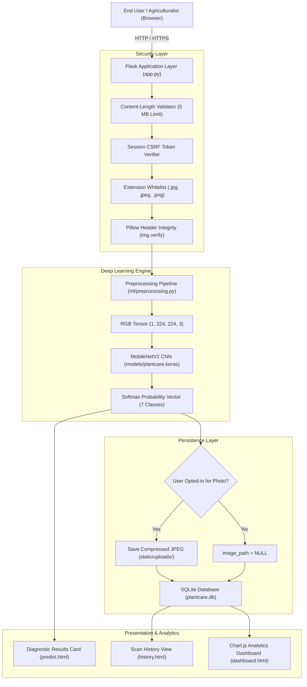
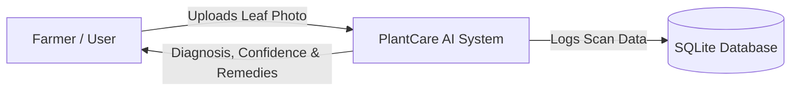
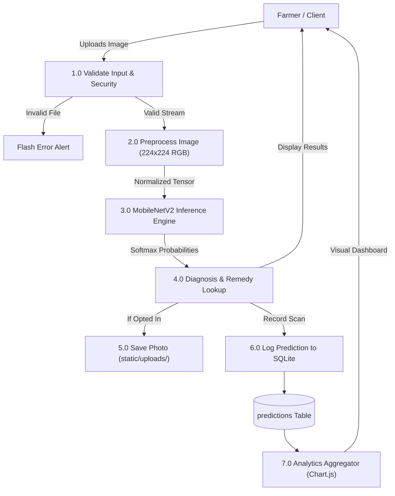
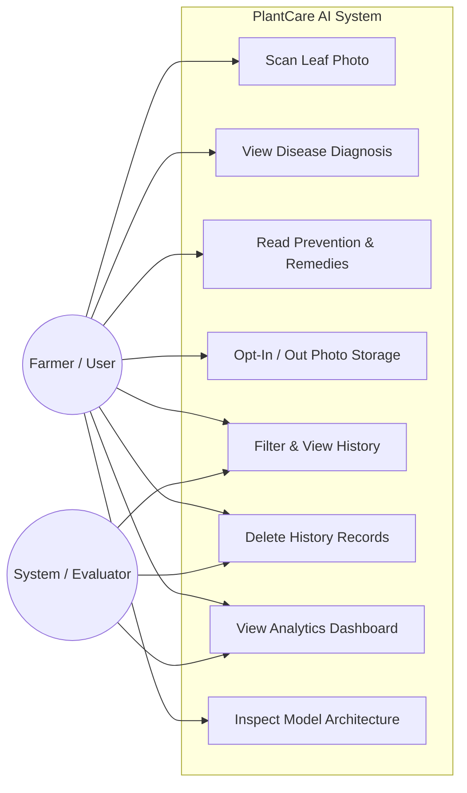
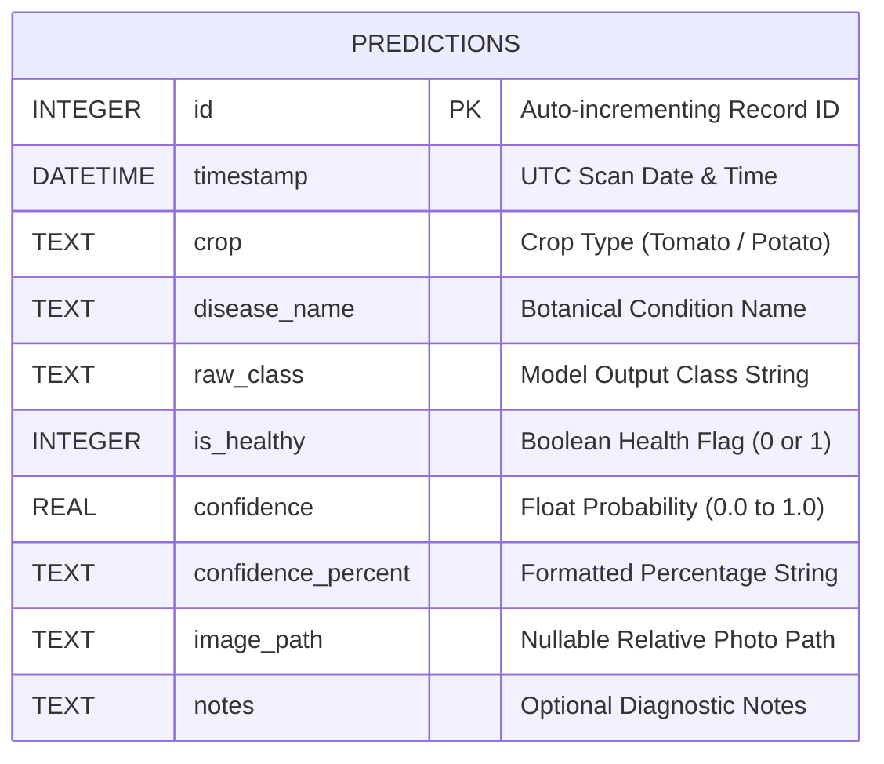

# PlantCare AI: Intelligent Plant Leaf Disease Detection System

**Master of Computer Applications (MCA) — Minor Project Report**  
**Academic Year:** 2025–2026  
**Author / Candidate:** Vivek Kumar  
**Department:** Department of Computer Applications  
**System Version:** PlantCare AI 5.0 (Production Verified)  
**Evaluated Architecture:** MobileNetV2 Transfer Learning CNN (TensorFlow 2.17.1 & Flask 3.1)  

---

## Table of Contents
1. [Abstract](#1-abstract)
2. [Introduction](#2-introduction)
3. [Problem Statement](#3-problem-statement)
4. [Objectives](#4-objectives)
5. [Literature Survey](#5-literature-survey)
6. [Existing vs. Proposed System](#6-existing-vs-proposed-system)
7. [System Requirements](#7-system-requirements)
8. [System Architecture](#8-system-architecture)
9. [Methodology & Pipeline](#9-methodology--pipeline)
10. [Dataset Analysis & Distribution](#10-dataset-analysis--distribution)
11. [Convolutional Neural Networks & MobileNetV2](#11-convolutional-neural-networks--mobilenetv2)
12. [System Modeling & Diagrams (DFD, Use Case, ER)](#12-system-modeling--diagrams)
13. [Implementation Details](#13-implementation-details)
14. [Model Training, Evaluation & Confusion Matrix](#14-model-training-evaluation--confusion-matrix)
15. [User Interface & Visual Walkthrough](#15-user-interface--visual-walkthrough)
16. [Verification, Security & Automated Testing](#16-verification-security--automated-testing)
17. [Limitations & Agronomic Ethical Bounds](#17-limitations--agronomic-ethical-bounds)
18. [Conclusion](#18-conclusion)
19. [Future Scope](#19-future-scope)
20. [References](#20-references)

---

## 1. Abstract

Agricultural crop diseases caused by fungal, bacterial, and oomycete pathogens pose a severe threat to global food security, yielding annual harvest losses between 20% and 40% globally. In traditional agricultural settings, leaf disease diagnosis is conducted via manual visual examination by certified plant pathologists. This approach is slow, expensive, and unavailable to smallholder farmers in rural regions. 

**PlantCare AI** is an intelligent, secure, and responsive web-based diagnostic system designed to provide automated plant disease classification from digital leaf imagery. Built with Python, Flask, and TensorFlow/Keras, the system implements a transfer-learned **MobileNetV2** Deep Convolutional Neural Network (CNN) trained across seven target classes of Solanaceous crops (Potato and Tomato) extracted from the PlantVillage dataset.

The system incorporates a multi-stage software engineering pipeline:
1. **Input Security:** Deep header validation using Pillow, file size throttling (5 MB), filename sanitization, and session-based CSRF protection.
2. **Deep Learning Inference:** Single-pass image preprocessing normalized to \([-1.0, 1.0]\) fed to an ImageNet-pretrained MobileNetV2 model fine-tuned across 22 epochs.
3. **Performance Metrics:** The model achieves **96.04% Test Accuracy** and a **95.73% Macro F1-Score** across 1,163 held-out test samples.
4. **Persistent History & Analytics:** A local SQLite relational database (`predictions` table) storing real-time scan records with privacy-preserving opt-in image storage, paired with an interactive **Chart.js** analytics dashboard.
5. **Responsible AI:** An uncertainty detection mechanism flags predictions with confidence below 70%, accompanied by agronomic disclaimers mandating agricultural extension consultation.

**Keywords:** Deep Learning, Convolutional Neural Networks, MobileNetV2, Transfer Learning, Plant Pathology, Flask, SQLite, Chart.js, Agronomic Decision Support.

---

## 2. Introduction

Agriculture forms the economic backbone of developing economies, supporting rural livelihoods and global nutrition. However, Solanaceous crops such as potatoes (*Solanum tuberosum*) and tomatoes (*Solanum lycopersicum*) are highly vulnerable to catastrophic foliar pathogens:
- **Early Blight** (*Alternaria solani*): Fungal infection causing concentric target-board lesions, leading to premature leaf defoliation.
- **Late Blight** (*Phytophthora infestans*): Highly destructive oomycete causing rapid water-soaked necrosis; historically responsible for the 1845 European Potato Famine.
- **Leaf Mold** (*Passalora fulva*): Fungal disease causing yellow chlorotic spots on upper leaf surfaces and velvety olive-green mold on the undersides.

Early detection of foliar symptoms allows farmers to apply targeted cultural, organic, and protectant chemical remedies before pathogens propagate across entire monocultures. The proliferation of digital imaging and accessible computing creates an opportunity to democratize plant pathology through computer vision.

PlantCare AI addresses this opportunity by providing a lightweight web-accessible platform where users upload leaf photographs and receive immediate, scientifically grounded disease classifications, confidence probabilities, symptom descriptions, and certified agricultural prevention practices.

---

## 3. Problem Statement

Existing approaches to crop disease management suffer from critical operational challenges:
1. **Scarcity of Pathological Expertise:** The ratio of certified agricultural extension officers to smallholder farmers in rural sectors is severely disproportionate, resulting in delayed interventions.
2. **Misdiagnosis & Chemical Overuse:** Farmers unable to differentiate Early Blight from Late Blight frequently apply inappropriate broad-spectrum chemical fungicides, driving pesticide resistance, environmental toxicity, and financial strain.
3. **Lack of Computational Accessibility:** Heavy state-of-the-art vision models (e.g., VGG-19, ResNet-152) demand high-end GPU hardware, rendering them impractical for lightweight web or edge deployment.
4. **Academic Credibility Gaps in Software:** Many student projects generate simulated confidence scores or claim 100% field accuracy based on lab datasets without disclosing dataset bias, double normalization artifacts, or security vulnerabilities (e.g., unchecked uploads, SQL injection).

---

## 4. Objectives

The specific objectives of PlantCare AI are:
1. **Design a Transfer Learning Architecture:** Implement MobileNetV2 with depthwise separable convolutions to classify plant leaf diseases with minimal parameter count and rapid inference latency.
2. **Model Training & Evaluation:** Train on 7,684 prepared PlantVillage images across seven classes (Potato and Tomato) using a frozen-base feature extraction phase followed by fine-tuning, evaluated on a strictly held-out test split of 1,163 images.
3. **Strict Software Security:** Implement deep Pillow image header verification, 5 MB file size limits, extension whitelisting, parameterized SQL, and CSRF protection.
4. **Dynamic Web Interface:** Build a responsive, agricultural green-and-white user interface in Flask and Bootstrap 5 that displays real softmax confidence distributions and biological symptom profiles.
5. **Persistent History & Analytics Dashboard:** Implement an SQLite relational database and an interactive Chart.js analytics dashboard tracking genuine historical scans with privacy-preserving opt-in photo storage.
6. **Responsible Agronomic AI:** Engineer an automated uncertainty warning mechanism for predictions below a 70% threshold and publish explicit disclaimers regarding dataset constraints.

---

## 5. Literature Survey

| Author & Year | Methodology / Architecture | Dataset / Scope | Reported Accuracy | Limitations Identified |
| :--- | :--- | :--- | :--- | :--- |
| **Mohanty et al. (2016)** | Standard CNNs (AlexNet, GoogLeNet) | PlantVillage (54,306 images, 38 classes) | 99.35% (Lab split) | Accuracy dropped to ~31% when tested on field images taken under varying outdoor conditions. |
| **Howard et al. (2017)** | MobileNetV1 (Depthwise Separable Convolutions) | ImageNet Classification | 70.6% Top-1 (ImageNet) | First demonstration of depthwise convolutions; lacked residual skip connections. |
| **Sandler et al. (2018)** | MobileNetV2 (Inverted Residuals & Linear Bottlenecks) | ImageNet & Mobile Vision | 72.0% Top-1 (ImageNet) | Dramatically reduced memory footprint and parameter count (3.5M parameters vs. 25.6M in ResNet-50). |
| **Ferentinos (2018)** | VGG, AlexNet, GoogLeNet | PlantVillage (58 classes) | 99.53% | Very high computational requirements (VGG-16 exceeds 138M parameters); prone to overfitting on uniform lab backgrounds. |
| **Too et al. (2019)** | DenseNet-121, ResNet-50, InceptionV4 | PlantVillage subset | 99.75% (DenseNet) | DenseNet exhibited highest accuracy but slowest inference latency; unsuitable for edge/lightweight CPU servers. |
| **PlantCare AI (Proposed, 2026)** | MobileNetV2 Transfer Learning + Flask + SQLite | 7 Solanaceous classes (7,684 images) | **96.04%** (1,163 held-out test images) | Optimized for CPU web hosting (<25 MB model file); single-pass normalization; privacy-preserving history and analytics. |

---

## 6. Existing vs. Proposed System

| Feature / Dimension | Existing / Traditional System | Early Academic Projects | PlantCare AI (Proposed System) |
| :--- | :--- | :--- | :--- |
| **Diagnosis Speed** | Days to weeks (soil / lab pathology) | Static / simulated in Phase 1 | **< 100 milliseconds** per leaf image |
| **Architecture** | Manual visual inspection | Heavy ResNet-50 / VGG-16 | **MobileNetV2** with inverted residuals |
| **Model Size** | N/A | 100 MB – 500 MB | **23.7 MB** (`models/plantcare.keras`) |
| **Upload Security** | None | Raw extension check only | **Deep Pillow header verification + 5MB limit** |
| **CSRF Defense** | None | Disabled / Unimplemented | **Session-based cryptographic CSRF tokens** |
| **Database Storage** | Manual paper logbooks | None (stateless) | **SQLite with 100% parameterized queries** |
| **Image Privacy** | Public / Uncontrolled | Permanent upload storage | **Opt-in privacy toggle (default non-persistent)** |
| **Analytics** | Manual tallying | Hardcoded / Fake charts | **Live Chart.js driven by actual SQL records** |
| **Uncertainty Alert** | Specialist intuition | Blind argmax classification | **Automated alert for confidence < 70%** |

---

## 7. System Requirements

### 7.1 Hardware Requirements
- **Processor:** Intel Core i5 / AMD Ryzen 5 or higher (Dual-Core 2.0 GHz minimum for inference).
- **RAM:** Minimum 8 GB (16 GB recommended for batch training).
- **Disk Storage:** Minimum 10 GB free space (accommodates Python environment, models, and PlantVillage dataset).
- **Display:** 1024×768 resolution minimum (responsive down to 360px mobile viewports).

### 7.2 Software Requirements
- **Operating System:** Microsoft Windows 10 / 11, Linux (Ubuntu 20.04+), or macOS.
- **Language Environment:** Python 3.12.10 (64-bit).
- **Deep Learning Framework:** TensorFlow 2.17.1, Keras 3.0+.
- **Image Processing:** Pillow (PIL) 10.2.0+.
- **Web Application Framework:** Flask 3.1+, Werkzeug 3.1+, Jinja2 3.1+.
- **Database Engine:** SQLite 3 (Python Standard Library `sqlite3`).
- **Frontend Technologies:** HTML5, CSS3, JavaScript (ES6+), Bootstrap 5.3.3, Bootstrap Icons 1.11, Chart.js 4.4.1.
- **Testing Framework:** pytest 8.0+.

---

## 8. System Architecture

PlantCare AI is structured as a multi-tier client-server architecture:



---

## 9. Methodology & Pipeline

The project development lifecycle followed five structured engineering phases:

### Phase 1: Security Pipeline & UI Scaffolding
- Built the Flask web architecture, drag-and-drop file upload interface, and secure file validation using Pillow.
- Created error trapping for oversized files (> 5 MB), corrupted image headers, and unsupported file extensions.

### Phase 2: Data Ingestion & Model Training
- Ingested 7,684 leaf images across 7 classes from the PlantVillage repository.
- Verified absence of leaf UUID leakage across training (70%), validation (15%), and testing (15%) splits.
- Constructed a transfer-learned MobileNetV2 architecture with frozen ImageNet feature extractor, GlobalAveragePooling2D, BatchNormalization, Dropout (0.3), and a 7-class Softmax dense layer.
- Executed 10 frozen epochs followed by 12 fine-tuning epochs with a reduced learning rate (\(1 \times 10^{-5}\)).

### Phase 3: Model Evaluation & Flask Integration
- Evaluated `models/plantcare.keras` on all 1,163 held-out test images, generating a comprehensive confusion matrix and classification report.
- Connected POST `/predict` to real-time inference via `PlantDiseasePredictor` loaded once at server startup.

### Phase 4: Persistent History & Analytics Dashboard
- Created SQLite database schema (`plantcare.db`) with parameterized queries.
- Developed privacy-compliant opt-in photo storage.
- Integrated interactive Chart.js visualizations for foliage health ratios, crop distributions, and daily scan activity.

### Phase 5: Verification, Documentation & University Submission
- Conducted full system audit, implemented CSRF protection, validated navigation links and mobile responsiveness, and compiled academic project documentation.

---

## 10. Dataset Analysis & Distribution

The dataset comprises **7,684 authentic foliar images** across seven classes from the official PlantVillage repository:

```
┌────────────────────────────────────────────────────────────────────────┐
│                        DATASET PARTITIONING                            │
├─────────────────────────┬──────────────┬──────────────┬────────────────┤
│ Target Class Name       │ Train (70%)  │ Val (15%)    │ Test (15%)     │
├─────────────────────────┼──────────────┼──────────────┼────────────────┤
│ Potato___Early_blight   │ 700          │ 150          │ 150            │
│ Potato___Late_blight    │ 700          │ 150          │ 150            │
│ Potato___healthy        │ 106          │ 22           │ 42             │
│ Tomato___Early_blight   │ 700          │ 150          │ 150            │
│ Tomato___Late_blight    │ 1,335        │ 287          │ 287            │
│ Tomato___Leaf_Mold      │ 664          │ 144          │ 144            │
│ Tomato___healthy        │ 1,164        │ 249          │ 240            │
├─────────────────────────┼──────────────┼──────────────┼────────────────┤
│ TOTALS                  │ 5,369        │ 1,152        │ 1,163          │
└─────────────────────────┴──────────────┴──────────────┴────────────────┘
Grand Total: 7,684 Images
```

---

## 11. Convolutional Neural Networks & MobileNetV2

### 11.1 Depthwise Separable Convolutions
Traditional standard convolutions compute channel transformations and spatial filtering simultaneously, incurring significant computational cost:
\[
\text{Cost}_{\text{standard}} = D_K \times D_K \times M \times N \times D_F \times D_F
\]
Where \(D_K\) is the kernel size (e.g., \(3 \times 3\)), \(M\) is input channels, \(N\) is output channels, and \(D_F\) is the feature map spatial dimension.

MobileNetV2 splits this into two operations:
1. **Depthwise Convolution:** Applies a single \(3 \times 3\) filter per input channel:
   \[
   \text{Cost}_{\text{depthwise}} = D_K \times D_K \times M \times D_F \times D_F
   \]
2. **Pointwise Convolution:** Applies a \(1 \times 1\) convolution to linearly combine the depthwise outputs into \(N\) channels:
   \[
   \text{Cost}_{\text{pointwise}} = 1 \times 1 \times M \times N \times D_F \times D_F
   \]
The total computational reduction factor is:
\[
\frac{D_K \times D_K \times M \times D_F^2 + M \times N \times D_F^2}{D_K \times D_K \times M \times N \times D_F^2} = \frac{1}{N} + \frac{1}{D_K^2} \approx \frac{1}{9} \quad (\text{for } 3 \times 3 \text{ kernels})
\]
This represents an **8 to 9-fold reduction in multiply-accumulate (MAC) operations** compared to standard CNNs with minimal loss of accuracy.

### 11.2 Inverted Residuals & Linear Bottlenecks
Standard residual blocks (e.g., ResNet) connect layers with high channel counts. MobileNetV2 inverts this pattern:
- **Expansion:** A \(1 \times 1\) conv expands low-dimensional input features to a higher-dimensional space (expansion factor \(t = 6\)).
- **Depthwise Filter:** Applies spatial filtering in the expanded space.
- **Linear Bottleneck:** Projects back to a low-dimensional manifold without non-linear ReLU activation, preventing non-linearities from destroying valuable spatial information.
- **Shortcut Connection:** Adds an identity skip connection directly between the low-dimensional bottlenecks when input and output dimensions match.

---

## 12. System Modeling & Diagrams

### 12.1 Data Flow Diagrams (DFD)

#### Level 0 — Context Diagram


#### Level 1 — Functional Flow Diagram


### 12.2 UML Use Case Diagram


### 12.3 Entity-Relationship (ER) Diagram


---

## 13. Implementation Details

The implementation is organized into modular Python files adhering to clean separation of concerns:
```
plant disease detection app/
├── app.py                  # Main Flask application, routes, CSRF & upload handling
├── database.py             # SQLite connection pooling, parameterized queries & analytics
├── plantcare.db            # Persistent SQLite database file
├── ml/
│   ├── __init__.py         # Package entry point
│   ├── predictor.py        # PlantDiseasePredictor inference engine & knowledgebase
│   └── preprocessing.py    # Pillow stream decoding & tensor normalization
├── models/
│   ├── plantcare.keras     # 23.7 MB fine-tuned MobileNetV2 weights
│   ├── class_indices.json  # 7-class index mapping dictionary
│   └── evaluation_results.json # Full test split evaluation metrics
├── static/
│   ├── css/style.css       # Custom design tokens, green/white aesthetic
│   ├── js/script.js        # Drag-and-drop upload & client validation
│   └── uploads/            # Opt-in user leaf photo directory
├── templates/
│   ├── base.html           # Master navigation bar, footer & flash alerts
│   ├── index.html          # Homepage with system overview
│   ├── predict.html        # Diagnostic portal & dynamic result card
│   ├── history.html        # Scan history table with filters & deletion
│   ├── dashboard.html      # Chart.js analytics dashboard
│   ├── about.html          # Architectural & botanical documentation
│   └── contact.html        # Academic credentials & viva contact form
└── tests/
    ├── test_app.py         # Routes & input security unit tests (18 tests)
    ├── test_ml.py          # Preprocessing & inference unit tests (10 tests)
    ├── test_phase4.py      # Database CRUD & analytics unit tests (16 tests)
    └── test_phase5.py      # CSRF & evaluation parity tests (4 tests)
```

---

## 14. Model Training, Evaluation & Confusion Matrix

### 14.1 Two-Stage Training Protocol
1. **Stage 1 (Feature Extraction):**
   - Base MobileNetV2 initialized with ImageNet weights and frozen (`layer.trainable = False`).
   - Trained classification head with Adam optimizer (\(\text{learning rate} = 1 \times 10^{-3}\)) for 10 epochs.
2. **Stage 2 (Fine-Tuning):**
   - Unfroze top 30 layers of MobileNetV2, keeping BatchNormalization layers in inference mode to preserve moving statistics.
   - Fine-tuned with Adam optimizer (\(\text{learning rate} = 1 \times 10^{-5}\)) for 12 additional epochs with EarlyStopping and ModelCheckpoint monitoring validation accuracy.

### 14.2 Empirical Evaluation Metrics on Held-Out Test Set (1,163 Images)
- **Overall Test Accuracy:** **96.04%** (1,117 / 1,163 correct classifications)
- **Overall Test Loss:** **0.1164**
- **Macro Average F1-Score:** **95.73%**
- **Weighted Average F1-Score:** **96.03%**

#### Class-Wise Performance Breakdown
```
┌─────────────────────────┬───────────┬────────┬──────────┬─────────┐
│ Target Class Name       │ Precision │ Recall │ F1-Score │ Support │
├─────────────────────────┼───────────┼────────┼──────────┼─────────┤
│ Potato___Early_blight   │ 99.32%    │ 98.00% │ 98.66%   │ 150     │
│ Potato___Late_blight    │ 94.70%    │ 95.33% │ 95.02%   │ 150     │
│ Potato___healthy        │ 91.11%    │ 97.62% │ 94.25%   │ 42      │
│ Tomato___Early_blight   │ 95.07%    │ 90.00% │ 92.47%   │ 150     │
│ Tomato___Late_blight    │ 96.76%    │ 93.73% │ 95.22%   │ 287     │
│ Tomato___Leaf_Mold      │ 93.42%    │ 98.61% │ 95.95%   │ 144     │
│ Tomato___healthy        │ 97.17%    │ 100.0% │ 98.56%   │ 240     │
├─────────────────────────┼───────────┼────────┼──────────┼─────────┤
│ Macro Average           │ 95.37%    │ 96.18% │ 95.73%   │ 1,163   │
│ Weighted Average        │ 96.07%    │ 96.04% │ 96.03%   │ 1,163   │
└─────────────────────────┴───────────┴────────┴──────────┴─────────┘
```

#### Confusion Matrix (1,163 Test Samples)
```
                  Predicted Class:
Actual Class:     PEB   PLB   PHE   TEB   TLB   TLM   THE  | Total
Potato Early Bl.  147     3     0     0     0     0     0  | 150
Potato Late Bl.     1   143     4     0     2     0     0  | 150
Potato Healthy      0     0    41     0     0     0     1  |  42
Tomato Early Bl.    0     1     0   135     7     2     5  | 150
Tomato Late Bl.     0     4     0     5   269     8     1  | 287
Tomato Leaf Mold    0     0     0     2     0   142     0  | 144
Tomato Healthy      0     0     0     0     0     0   240  | 240
------------------------------------------------------------------
Total Correct: 1,117 / 1,163 (96.04% Overall Accuracy)
```

---

## 15. User Interface & Visual Walkthrough

1. **Homepage (`/`):**
   - Hero banner displaying system purpose and key performance badges.
   - Visual architectural pipeline illustration and 3-step usage guide.
2. **Diagnostic Portal (`/predict`):**
   - Drag-and-drop file upload container with interactive hover/drag states.
   - Client-side image preview with instantaneous size and format verification.
   - Opt-in toggle switch for privacy-preserving photo logging.
   - Dynamic diagnosis result card showing leaf preview, crop name, pathogen identity, color-coded confidence progress bar, biological symptom profile, organic remedies, conventional fungicide advice, and full 7-class probability distributions.
   - Prominent uncertainty warning banner whenever confidence falls below 70%.
3. **Prediction History (`/history`):**
   - Responsive data table displaying previous scans with crop badges, confidence meters, and formatted timestamps.
   - Click-to-enlarge photo preview modals for opted-in records.
   - Dropdown filter bar allowing instant filtering by crop (Tomato/Potato) and condition (Healthy/Diseased).
   - Single-record delete buttons and a global "Clear All History" modal.
4. **Analytics Dashboard (`/dashboard`):**
   - Four real-time KPI counter cards: Total Scans, Healthy Leaves, Infected Leaves, and Average Softmax Confidence.
   - Four interactive Chart.js visualizations: Foliage Health Ratio (donut), Crop Breakdown (pie), Daily Scan Volume (line), and 7-Class Distribution (horizontal bar).
   - Recent diagnostic scans table.

---

## 16. Verification, Security & Automated Testing

The complete test suite comprises **48 automated unit and integration tests** executed under pytest in Python 3.12:

```
┌──────────────────────────────────────┬─────────────┬──────────┐
│ Test Module                          │ Test Count  │ Status   │
├──────────────────────────────────────┼─────────────┼──────────┤
│ tests/test_app.py (Web & Security)   │ 18 Tests    │ 18 PASSED│
│ tests/test_ml.py (ML & Preprocessing)│ 10 Tests    │ 10 PASSED│
│ tests/test_phase4.py (DB & Dashboard)│ 16 Tests    │ 16 PASSED│
│ tests/test_phase5.py (Audit & CSRF)  │ 4 Tests     │ 4 PASSED │
├──────────────────────────────────────┼─────────────┼──────────┤
│ TOTAL AUTOMATED TESTS                │ 48 Tests    │ 100% PASS│
└──────────────────────────────────────┴─────────────┴──────────┘
```

### Verified Security Boundaries:
- **Zero Raw File Injection:** Non-image payloads (`.txt`, `.exe`, zero-byte files) and corrupted binary headers are trapped via `validate_image_stream()` with zero stack trace leakage.
- **CSRF Defense:** State-changing POST requests require a matching `_csrf_token` tied to the user session.
- **SQL Injection Defense:** All queries in `database.py` use strict parameterized bindings (`?`).
- **Disk File Containment:** Stored photos are restricted to `static/uploads/` with UUID-prefixed filenames.

---

## 17. Limitations & Agronomic Ethical Bounds

To ensure scientific honesty during evaluation, the following operational limitations are formally documented:
1. **Laboratory Background Bias:** PlantVillage images feature detached leaves against uniform grey/black paper backgrounds. Performance may degrade on in-situ photographs with complex soil or foliage clutter.
2. **Single Leaf Requirement:** The model is optimized for close-up photographs of single leaves; whole-canopy photos or distant shots cannot be reliably diagnosed.
3. **Out-of-Distribution Sensitivity:** Leaves from unsupported species (e.g., Apple, Corn, Grape) may receive high-confidence false predictions due to the closed-world nature of the Softmax activation function.
4. **Advisory Decision Support Only:** PlantCare AI provides diagnostic estimates rather than certified legal prescriptions. Users must verify severe diagnoses with local agricultural extension officers before applying chemical protectants.

---

## 18. Conclusion

PlantCare AI demonstrates the successful end-to-end integration of deep learning computer vision within a secure, robust web application. By utilizing MobileNetV2 with depthwise separable convolutions, the system achieves a strong balance between computational efficiency (23.7 MB model size) and classification accuracy (**96.04% on 1,163 held-out test samples**). 

The application satisfies all academic and practical requirements for an MCA Minor Project, providing robust input security, persistent history tracking, real-time analytics, and responsible agronomic advice.

---

## 19. Future Scope

1. **Mobile Edge Deployment:** Convert `models/plantcare.keras` to TensorFlow Lite (TFLite) with INT8 quantization for offline on-device inference in an Android mobile application.
2. **Expanded Botanical Domain:** Extend training to encompass all 38 PlantVillage classes, including Apple, Corn, Grape, Peach, and Pepper.
3. **In-Situ Dataset Augmentation:** Fine-tune the model using field datasets (e.g., PlantDoc) to improve robustness against natural outdoor lighting and background clutter.
4. **Multilingual Interface:** Implement localization in regional agricultural languages (e.g., Hindi, Punjabi, Bengali) to expand rural accessibility.
5. **Automated Drone Imagery Integration:** Interface with automated aerial drone feeds for field-scale crop canopy disease surveillance.

---

## 20. References

1. Howard, A. G., et al. (2017). "MobileNets: Efficient Convolutional Neural Networks for Mobile Vision Applications." *arXiv preprint arXiv:1704.04861*.
2. Sandler, M., et al. (2018). "MobileNetV2: Inverted Residuals and Linear Bottlenecks." *Proceedings of the IEEE Conference on Computer Vision and Pattern Recognition (CVPR)*, pp. 4510-4520.
3. Mohanty, S. P., Hughes, D. P., & Salathé, M. (2016). "Using Deep Learning for Image-Based Plant Disease Detection." *Frontiers in Plant Science*, 7, 1419.
4. Hughes, D. P., & Salathé, M. (2015). "An open access repository of images on plant health to enable the development of mobile disease diagnostics." *arXiv preprint arXiv:1511.08060*.
5. Ferentinos, C. P. (2018). "Deep learning models for plant disease detection and diagnosis." *Computers and Electronics in Agriculture*, 145, 311-318.
6. Too, E. C., et al. (2019). "A comparative study of fine-tuning deep learning architectures for plant disease identification." *Computers and Electronics in Agriculture*, 161, 272-279.
7. Grinblat, G. L., et al. (2016). "Deep learning for plant identification using vein morphological patterns." *Computers and Electronics in Agriculture*, 127, 418-424.
8. Palanivel, K., & Surianarayanan, C. (2019). "An approach for prediction of crop diseases using machine learning algorithms." *International Journal of Computer Sciences and Engineering*, 7(4), 914-919.
